# InterviewAI

## AI Voice Interview Preparation Platform & Resume Analyzer

> A mobile-first, AI-powered interview preparation platform. Users
> schedule realistic mock interviews, speak with an AI interviewer,
> review recordings and transcripts, receive structured feedback, and
> analyze their resumes against target roles.

**Project status:** Architecture and planning\
**Initial implementation target:** Backend foundation\
**Frontend:** React Native + Expo\
**Primary backend:** Django REST Framework\
**AI services:** FastAPI + locally hosted models\
**Infrastructure philosophy:** Open-source, self-hosted where practical,
and no mandatory paid AI APIs.

------------------------------------------------------------------------

## Table of Contents

1.  [Product Vision](#1-product-vision)
2.  [Goals and Non-Goals](#2-goals-and-non-goals)
3.  [Core Features](#3-core-features)
4.  [Technology Stack](#4-technology-stack)
5.  [High-Level Architecture](#5-high-level-architecture)
6.  [System Components and
    Responsibilities](#6-system-components-and-responsibilities)
7.  [Voice Interview Lifecycle](#7-voice-interview-lifecycle)
8.  [Interview State Machine](#8-interview-state-machine)
9.  [Resume Analysis Workflow](#9-resume-analysis-workflow)
10. [Push Notification Workflow](#10-push-notification-workflow)
11. [Database Architecture](#11-database-architecture)
12. [Observability Architecture](#12-observability-architecture)
13. [Usage and Cost Monitoring](#13-usage-and-cost-monitoring)
14. [Security, Privacy, and
    Reliability](#14-security-privacy-and-reliability)
15. [Repository Structure](#15-repository-structure)
16. [API Design](#16-api-design)
17. [Deployment Architecture](#17-deployment-architecture)
18. [Development Roadmap](#18-development-roadmap)
19. [Local Development Strategy](#19-local-development-strategy)
20. [Important Architecture
    Decisions](#20-important-architecture-decisions)
21. [License and Model
    Considerations](#21-license-and-model-considerations)

------------------------------------------------------------------------

## 1. Product Vision

InterviewAI helps candidates prepare for upcoming job interviews through
realistic AI-powered voice interviews and actionable resume feedback.

A user can:

1.  Register and create a professional profile.
2.  Add experience, skills, target roles, and career preferences.
3.  Schedule a mock interview for a specific date and time.
4.  Specify the job role, experience level, technology stack,
    difficulty, duration, and custom requirements.
5.  Receive a reminder before the scheduled interview.
6.  Join a voice interview from the mobile application.
7.  Speak naturally with an AI interviewer that asks follow-up questions
    based on the candidate's answers.
8.  Review the interview recording, transcript, and question-wise
    evaluation.
9.  Track performance across previous interviews.
10. Upload a resume and receive structured feedback.
11. Compare a resume with a target job description and identify gaps.

### Primary user journey

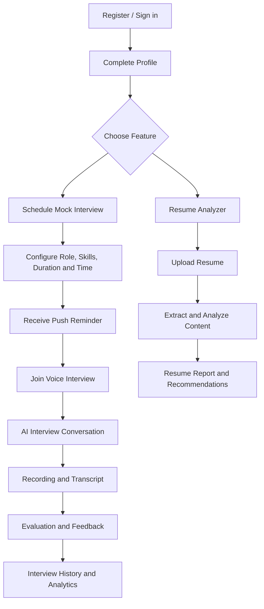

------------------------------------------------------------------------

## 2. Goals and Non-Goals

### Goals

-   Build a complete mobile-first product for Android and iOS.
-   Keep the main business backend independent of the mobile client.
-   Use local or self-hosted AI models to avoid mandatory per-request
    paid AI APIs.
-   Support realistic, dynamic voice interviews rather than a static
    question-and-answer script.
-   Record interviews with explicit user consent.
-   Provide transcripts, structured evaluations, and historical
    performance tracking.
-   Analyze PDF and DOCX resumes.
-   Instrument the system for logs, metrics, traces, alerts, and
    resource usage.
-   Measure estimated infrastructure cost and resource consumption per
    user and interview.
-   Design for recoverability, security, and incremental scaling.

### Non-goals for the first release

-   No paid telephony provider or guaranteed free outbound PSTN phone
    calls.
-   No Kubernetes requirement for the initial deployment.
-   No microservices for every business domain.
-   No dependence on paid LLM, speech-to-text, or text-to-speech APIs.
-   No use of Firebase as the primary business database or task queue.
-   No claim that an AI-generated score is an objective measure of
    employability.

### Voice delivery approach

The first implementation will use **browser-free, in-app voice
communication through the React Native application and LiveKit**. The
user receives a push notification and joins the interview room at the
scheduled time.

Actual outbound mobile phone calls are a possible later extension.
Reliable PSTN calling generally requires telephony infrastructure and
may incur costs. The AI interview engine should remain independent of
the transport so a phone channel can be added later.

------------------------------------------------------------------------

## 3. Core Features

### 3.1 Identity, authentication, and user profile

InterviewAI will support consumer authentication as well as enterprise
identity federation. Django remains the identity authority for the
application: it owns the local user record, authorization, account
lifecycle, and application sessions. External identity providers prove
identity; they do not become the source of truth for InterviewAI roles
or permissions.

Authentication capabilities:

-   Email/password registration and login.
-   Email verification and password reset.
-   MFA (multi-factor authentication), with 2FA treated as the common
    two-factor case.
-   TOTP authenticator-app codes as the initial MFA method.
-   Recovery/backup codes, stored securely and single-use.
-   WebAuthn/passkeys as a stronger passwordless or second-factor option
    in a later authentication milestone.
-   Social login, initially Google and Apple; GitHub can be added for
    developer-focused users if product requirements justify it.
-   Enterprise SSO through OpenID Connect (OIDC) and SAML 2.0, with
    organization-level identity-provider configuration.
-   Secure account linking/unlinking and management of connected
    identity providers.
-   Short-lived access tokens, refresh-token rotation/revocation, device
    and session management, and account recovery.
-   Optional organization policies: require MFA, allow selected identity
    providers, and enforce SSO for organization members.

Important distinctions:

-   **MFA** means using two or more independent authentication factors.
    **2FA** is specifically two factors; we will implement a common MFA
    policy engine that can enforce two-factor or stronger policies.
-   Social login is an authentication method, not enterprise SSO.
-   OIDC and SAML SSO are federation protocols for an organization
    identity provider. They are separate from consumer social login,
    even where the same provider (for example Google) supports both.
-   A successful external login does not grant application permissions.
    Django maps the authenticated identity to a local user and applies
    InterviewAI authorization rules.
-   Never silently merge accounts only because two providers return the
    same email. Require a verified identity and an authenticated,
    explicit account-linking flow.

Firebase Authentication is not part of this design. Firebase remains a
mobile services layer for push notifications, crash reporting,
analytics, and related app services.

### 3.2 Interview scheduling and management

Users configure:

-   Job role and job title.
-   Experience level or years of experience.
-   Technical stack and skills.
-   Interview type: technical, HR, DSA, system design, behavioral,
    project-based, or custom.
-   Difficulty level.
-   Duration.
-   Scheduled date and time.
-   Time zone.
-   Additional instructions and focus areas.

Interview lifecycle includes scheduling, rescheduling, cancellation,
preparation, joining, completion, processing, failure handling, and
no-show handling.

### 3.3 AI voice interview

-   Generate an interview plan based on the user's configuration.
-   Ask questions in stages.
-   Convert the candidate's speech into text.
-   Detect speech boundaries and pauses.
-   Evaluate answers and decide suitable follow-up questions.
-   Adapt question difficulty within configured limits.
-   Track remaining interview time and question limits.
-   Convert AI responses into speech.
-   Support interruptions, reconnects, and controlled session
    termination.

### 3.4 Recording and transcript

-   Server-side recording of the interview room.
-   Separate or identifiable interviewer and candidate tracks where
    supported by the recording configuration.
-   Audio storage outside the relational database.
-   Timestamped transcript segments.
-   Speaker identification.
-   Playback and transcript review.
-   Retention and deletion policies.

Recording must be disclosed and consent must be obtained before
recording begins.

### 3.5 Interview evaluation

The final report may include:

-   Overall score.
-   Technical correctness.
-   Depth of understanding.
-   Problem-solving approach.
-   Practical knowledge.
-   Communication and answer clarity.
-   Relevance to the question.
-   Strengths and improvement areas.
-   Question-wise feedback.
-   Suggested topics and practice exercises.

Scores should be accompanied by explanations and evidence from the
transcript. They are coaching estimates, not definitive hiring
decisions.

### 3.6 Resume analyzer

-   PDF and DOCX upload.
-   File validation and safe text extraction.
-   Resume section and skill extraction.
-   Experience and project analysis.
-   Clarity, structure, and readability feedback.
-   Job-description matching.
-   Missing or under-evidenced skill identification.
-   Actionable improvement suggestions.
-   Structured analysis reports and analysis history.

### 3.7 History and analytics

-   Past and upcoming interviews.
-   Interview status and duration.
-   Recordings and transcripts.
-   Historical scores and category trends.
-   Frequently weak topics.
-   Resume analysis history.
-   Usage and quota information.

### 3.8 Administration

-   User and account management.
-   Interview and job monitoring.
-   Failed background task inspection.
-   Usage and resource dashboards.
-   Storage consumption and retention.
-   Operational alerts and audit trails.

------------------------------------------------------------------------

## 4. Technology Stack

The stack is selected to keep the product Python-first on the backend
and cross-platform on mobile.

  -----------------------------------------------------------------------
  Layer                   Technology              Role
  ----------------------- ----------------------- -----------------------
  Mobile application      React Native            Cross-platform Android
                                                  and iOS application

  Mobile tooling          Expo development builds Native project tooling,
                                                  builds, permissions,
                                                  and development
                                                  workflow

  Mobile language         TypeScript              Type-safe mobile code

  Navigation              Expo Router             File-based mobile
                                                  navigation

  Server state            TanStack Query          API fetching, caching,
                                                  retries, and
                                                  invalidation

  Client state            Zustand                 Local/global UI and
                                                  session state

  Forms                   React Hook Form + Zod   Form state and
                                                  validation

  Main backend            Django                  Business domain,
                                                  authentication,
                                                  administration

  API framework           Django REST Framework   Versioned REST APIs

  AI service API          FastAPI                 AI and audio service
                                                  interfaces

  Primary database        PostgreSQL              Durable relational
                                                  business data

  Cache and broker        Redis                   Caching, Celery broker,
                                                  short-lived
                                                  coordination

  Background processing   Celery                  Asynchronous jobs

  Scheduling              Celery Beat             Periodic tasks and
                                                  scheduled-work dispatch

  Real-time communication LiveKit self-hosted     Low-latency audio rooms
                                                  and participant
                                                  communication

  LLM runtime             Ollama                  Local model serving and
                                                  inference API

  Speech-to-text          faster-whisper          Local speech
                                                  recognition

  Voice activity          Silero VAD              Speech/silence boundary
  detection                                       detection

  Text-to-speech          Piper                   Local speech synthesis

  Audio processing        FFmpeg                  Audio conversion,
                                                  normalization, and
                                                  media processing

  Resume PDF parsing      PyMuPDF                 PDF text extraction

  Resume DOCX parsing     python-docx             DOCX text extraction

  Object storage          MinIO                   S3-compatible storage
                                                  for resumes and
                                                  recordings

  Push notifications      Firebase Cloud          Mobile push delivery
                          Messaging               

  Mobile crash reporting  Firebase Crashlytics    Mobile crash
                                                  diagnostics

  Mobile analytics        Firebase Analytics      Mobile product usage
                                                  analytics

  Mobile performance      Firebase Performance    Mobile app performance
                          Monitoring              monitoring

  Firebase protection     Firebase App Check      Attestation for
                                                  supported Firebase
                                                  resources

  Reverse proxy           Nginx                   TLS termination,
                                                  routing, and request
                                                  limits

  Containers              Docker + Docker Compose Reproducible local and
                                                  initial production
                                                  deployment

  Metrics                 Prometheus              Time-series metrics
                                                  collection

  Dashboards and alerting Grafana                 Operational dashboards
                                                  and alert visualization

  Log aggregation         Grafana Loki            Centralized structured
                                                  logs

  Distributed tracing     OpenTelemetry + Grafana Cross-service request
                          Tempo                   tracing

  Testing                 pytest, Django          Unit, integration, and
                          TestCase, API tests     end-to-end testing

  CI/CD                   GitHub Actions          Automated tests,
                                                  checks, and deployment
                                                  workflows
  -----------------------------------------------------------------------

### 4.1 Role of Django

Django is the main application backend and source of truth for business
data.

Responsibilities:

-   User registration and authentication.
-   Authorization and permissions.
-   Profiles and user preferences.
-   Interview configuration and scheduling.
-   Interview lifecycle and session metadata.
-   Resume metadata and analysis history.
-   Evaluation and result APIs.
-   Device token registration.
-   Notification preferences and delivery records.
-   Usage and audit records.
-   Admin operations.

Django should not hold a normal HTTP request open while a 30-minute
interview runs. It creates and manages the session while the real-time
voice service handles the conversation.

### 4.2 Role of FastAPI

FastAPI hosts AI-specific interfaces and orchestration.

Responsibilities:

-   AI interview orchestration.
-   Model inference integration.
-   Speech-to-text and text-to-speech interfaces.
-   Transcript processing.
-   Answer evaluation.
-   Resume analysis orchestration.
-   AI health and readiness endpoints.

Long-running processing should be managed through background workers or
controlled streaming pipelines, not by tying up ordinary API workers.

### 4.3 Role of PostgreSQL

PostgreSQL is the primary durable database.

It stores:

-   Users and profiles.
-   Interview configurations and schedules.
-   Interview sessions and lifecycle state.
-   Questions and answers.
-   Transcript metadata and segments.
-   Recording metadata and storage keys.
-   Evaluation results.
-   Resume metadata and analysis reports.
-   Device registrations and notification records.
-   Usage, audit, and operational records.

Audio files and uploaded documents are stored in object storage, not as
large binary values in ordinary relational rows.

### 4.4 Role of Redis and Celery

Redis is used for:

-   Celery message broker.
-   Short-lived cache.
-   Distributed coordination where appropriate.
-   Rate-limit or ephemeral state support.

Celery is used for:

-   Interview reminder dispatch.
-   Interview preparation jobs.
-   Resume parsing and analysis.
-   Post-interview transcript processing.
-   Final evaluation generation.
-   Recording processing.
-   Notification delivery.
-   Cleanup and retention jobs.

Celery Beat dispatches periodic work. Scheduled jobs must be idempotent
and protected against duplicate execution.

Redis is not the durable source of truth for interview state.

### 4.5 Role of Firebase

Firebase is an auxiliary mobile-services layer only. It does not replace
PostgreSQL, Redis, Celery, Django authentication, or MinIO.

  ---------------------------------------------------------------------
  Firebase product                   Responsibility
  ---------------------------------- ----------------------------------
  Firebase Cloud Messaging (FCM)     Push notifications to registered
                                     Android/iOS devices

  Crashlytics                        Mobile crash reports and
                                     diagnostics

  Analytics                          App usage and engagement events

  Performance Monitoring             Mobile startup, screen, and
                                     network performance

  App Check                          Protect supported Firebase
                                     resources from unauthorized
                                     clients
  ---------------------------------------------------------------------

The backend sends FCM notifications using the Firebase Admin SDK. The
Admin SDK credentials must remain on the server and must never be
embedded in the mobile application.

The initial design uses Django/JWT authentication. Firebase
Authentication is not required.

**Billing note:** Firebase products have different pricing and plan
restrictions. Use only services and features available under the
selected no-cost plan, verify current quotas before deployment, and
avoid enabling billing-dependent features unintentionally. Mobile
app-store publishing may have separate developer account fees.

### 4.6 Role of LiveKit

LiveKit provides real-time audio communication between the candidate's
mobile app and the AI participant/agent.

Responsibilities:

-   Interview room creation and access.
-   Participant connection.
-   Audio publication and subscription.
-   Reconnection support.
-   Room lifecycle.
-   Server-side recording integration through Egress.

The backend creates authorized room tokens. The mobile app must never
receive server API secrets.

Self-hosted LiveKit requires its supporting infrastructure and
configuration. Egress is a separately deployed recording component.

### 4.7 Role of local AI models

The AI system is designed around local/self-hosted inference.

  -----------------------------------------------------------------------
  Component               Technology              Responsibility
  ----------------------- ----------------------- -----------------------
  LLM runtime             Ollama                  Serve selected local
                                                  language models

  Speech recognition      faster-whisper          Convert candidate
                                                  speech to text

  VAD                     Silero VAD              Detect speech segments

  Speech synthesis        Piper                   Generate interviewer
                                                  speech

  Audio utilities         FFmpeg                  Convert and normalize
                                                  media
  -----------------------------------------------------------------------

Model selection must be based on measured quality, latency, memory use,
hardware capability, and licensing. Model weights and voice assets can
have separate licenses from their runtime software. Verify
commercial-use rights before public launch.

------------------------------------------------------------------------

### 4.8 Provider independence and portability (core architecture requirement)

**Provider independence is a non-negotiable design rule for this
project.**

We will start with free, local, or self-hosted providers, but
application business logic must not depend directly on a vendor SDK,
provider-specific response object, proprietary model identifier, or
provider-specific error format.

The target is:

-   For providers that already implement our adapter contract or a
    compatible API: switch by changing environment configuration and
    credentials.
-   For providers with a different API or capability model: add a small
    adapter in the infrastructure/integration layer, then switch
    configuration.
-   Do not rewrite interview scheduling, state management, evaluation
    rules, resume workflows, or database business logic when changing a
    provider.

This is an adapter/ports-and-adapters approach (also known as hexagonal
architecture), supported by dependency inversion.

#### Provider abstraction architecture

``` mermaid
flowchart TB
    DOMAIN["Application / Domain Logic"]
    PORTS["Stable Internal Interfaces (Ports)"]

    DOMAIN --> PORTS

    PORTS --> LLM["LLM Adapter"]
    PORTS --> STT["Speech-to-Text Adapter"]
    PORTS --> TTS["Text-to-Speech Adapter"]
    PORTS --> EMB["Embedding / Reranking Adapter"]
    PORTS --> STORE["Object Storage Adapter"]
    PORTS --> NOTIFY["Notification Adapter"]
    PORTS --> EMAIL["Email Adapter"]
    PORTS --> REALTIME["Real-Time Session Adapter"]

    LLM --> LLMLOCAL["Ollama / Local OpenAI-compatible endpoint"]
    LLM --> LLMPAID["OpenAI / Anthropic / Gemini / Azure / other supported API"]
    STT --> STTLOCAL["faster-whisper / local STT"]
    STT --> STTPAID["Deepgram / AssemblyAI / cloud STT"]
    TTS --> TTSLOCAL["Piper / local TTS"]
    TTS --> TTSPAID["Cloud TTS providers"]
    EMB --> EMBLOCAL["Local embedding model"]
    EMB --> EMBPAID["Hosted embedding / reranking API"]
    STORE --> MINIO["MinIO"]
    STORE --> S3["AWS S3 / compatible object storage"]
    NOTIFY --> FCM["Firebase FCM"]
    NOTIFY --> OTHERPUSH["Other push provider / APNs adapter"]
    EMAIL --> SMTP["SMTP"]
    EMAIL --> EMAILAPI["Email API provider"]
    REALTIME --> LIVEKIT["Self-hosted LiveKit"]
    REALTIME --> OTHERRTC["Alternative real-time provider adapter"]
```

#### Stable internal interfaces

Create explicit interfaces/Protocols and normalized application-level
data contracts. Suggested interfaces:

  ---------------------------------------------------------------------------
  Interface                   Responsibility          Initial adapter
  --------------------------- ----------------------- -----------------------
  `LLMProvider`               Generate text,          LiteLLM-backed adapter
                              structured output, and  / Ollama
                              streaming responses     

  `SpeechToTextProvider`      Convert audio to        faster-whisper
                              timestamped transcript  
                              segments                

  `TextToSpeechProvider`      Synthesize audio from   Piper
                              text                    

  `VoiceActivityDetector`     Detect speech           Silero VAD
                              boundaries              

  `EmbeddingProvider`         Generate embeddings     Local embedding model

  `RerankerProvider`          Rank retrieved content  Local reranker or no-op
                                                      initially

  `ObjectStorageProvider`     Upload, download,       MinIO using
                              delete, and sign object S3-compatible API
                              access                  

  `NotificationProvider`      Send push notification  Firebase FCM
                              events                  

  `EmailProvider`             Send transactional      SMTP/local development
                              email                   adapter initially

  `RealtimeSessionProvider`   Create rooms, issue     LiveKit
                              access, inspect and end 
                              sessions                

  `TaskBroker`                Queue transport         Celery with Redis
                              configuration           initially
  ---------------------------------------------------------------------------

The domain layer should consume our own normalized request/response
types, not SDK-specific classes. For example, an LLM call should return
our internal `LLMResult` with normalized text, structured data, token
usage when available, provider/model metadata, finish reason, and
timing.

Use Pydantic schemas for AI service boundaries and validate structured
model output before it reaches business logic.

#### LLM portability

Use **LiteLLM as the initial LLM integration layer** behind our own
`LLMProvider` interface. LiteLLM provides a unified interface to many
hosted and self-hosted providers, including Ollama, and can normalize
common chat-completion calls. Its optional proxy can provide a
centralized OpenAI-compatible gateway, routing, retries, fallbacks, and
spend tracking.

Initial approach:

1.  The application calls our internal `LLMProvider`.
2.  The default adapter calls LiteLLM.
3.  LiteLLM routes to Ollama initially.
4.  A future compatible provider is selected through configuration.
5.  Provider-specific behavior stays inside the adapter/gateway
    boundary.

Example configuration:

``` dotenv
AI_LLM_ADAPTER=litellm
AI_LLM_PROVIDER=ollama
AI_LLM_MODEL=ollama/<chosen-local-model>
AI_LLM_API_BASE=http://ollama:11434
AI_LLM_API_KEY=
AI_LLM_TIMEOUT_SECONDS=60
AI_LLM_MAX_RETRIES=2
AI_LLM_FALLBACK_PROVIDER=
AI_LLM_FALLBACK_MODEL=
```

A later provider change might look like:

``` dotenv
AI_LLM_ADAPTER=litellm
AI_LLM_PROVIDER=openai
AI_LLM_MODEL=openai/<chosen-model>
AI_LLM_API_KEY=<secret-from-secret-manager>
AI_LLM_API_BASE=
```

Exact model names and configuration keys must match the chosen LiteLLM
provider integration. Never hard-code provider keys in source code.

**Important:** A model change can alter structured-output support, tool
calling, context limits, streaming behavior, latency, cost, and answer
quality. Our adapter must expose capability checks and fail clearly when
a selected model cannot satisfy a required capability. Contract tests
and prompt/evaluation regression tests are required before production
switching.

For voice sessions, LiveKit Agents provides a model/plugin architecture
for LLM, STT, and TTS integrations. We will use its provider plugins or
a small internal adapter to connect the configured providers to the
voice agent. Do not let LiveKit plugin-specific objects leak into
interview domain models.

#### STT and TTS portability

Keep the speech interfaces independent:

``` dotenv
VOICE_STT_PROVIDER=faster_whisper
VOICE_STT_MODEL=<local-model>
VOICE_STT_LANGUAGE=auto

VOICE_TTS_PROVIDER=piper
VOICE_TTS_MODEL=<local-voice-model>
VOICE_TTS_LANGUAGE=en

VOICE_VAD_PROVIDER=silero
```

A future STT or TTS provider should be selectable through configuration
when a compatible LiveKit Agents plugin or our adapter already exists.
If not, implement a new adapter that converts provider-specific
streaming/audio formats into our normalized audio and transcript
contracts.

Do not assume that all speech providers support the same languages,
streaming mode, diarization, word timestamps, interruption behavior, or
audio formats. Validate capabilities at startup and test Hindi/English
performance explicitly.

#### Storage portability

Use an object-storage abstraction and S3-compatible API wherever
possible.

Initial storage:

``` dotenv
STORAGE_BACKEND=s3
S3_ENDPOINT_URL=http://minio:9000
S3_BUCKET=interview-ai
S3_ACCESS_KEY_ID=<local-secret>
S3_SECRET_ACCESS_KEY=<local-secret>
S3_REGION=us-east-1
S3_USE_SSL=false
```

A move to AWS S3 or another S3-compatible service should normally
require configuration and credentials changes, plus a controlled data
migration. Use Django's storage API or a dedicated storage adapter;
business code should use operations such as `put`, `get`, `delete`,
`exists`, and `create_download_url`, not MinIO-specific methods.

Do not expose bucket paths or provider-specific URLs as permanent public
identifiers. Persist an opaque object key and generate authorized access
URLs when needed.

#### Notification portability

The domain emits a notification intent, for example
`InterviewReminderDue`. A `NotificationProvider` adapter handles
delivery.

Initial provider:

``` dotenv
NOTIFICATION_PROVIDER=fcm
FIREBASE_PROJECT_ID=<project-id>
FIREBASE_CREDENTIALS_FILE=<server-side-credentials-path>
```

A future provider can be introduced with another adapter. Device
registration, notification preferences, templates, delivery status, and
retry policy remain application-owned. Provider-specific device tokens
must be stored with their provider/platform metadata.

#### Real-time transport portability

Keep interview session identity, candidate identity, consent, and
interview state independent from LiveKit room IDs and SDK event objects.

The initial `RealtimeSessionProvider` uses LiveKit. A future provider
may require a new server adapter and a mobile SDK/client integration.
This is **not guaranteed to be environment-only**, because real-time
providers can differ in room APIs, token formats, SDKs, recording, and
event semantics.

#### Task broker and cache portability

Keep Celery tasks independent of Redis commands. Configure the broker
and result backend through environment variables. Celery supports
multiple broker transports, but transport semantics, delivery
guarantees, visibility timeouts, and operational behavior differ.
Switching broker infrastructure requires configuration, deployment, and
integration testing.

Use Django's cache interface for application caching rather than direct
Redis commands in domain code, except where Redis-specific atomic
primitives are deliberately isolated behind a small adapter.

#### Configuration and secrets

-   Use typed settings with validation at startup.
-   Keep non-secret configuration in environment variables.
-   Keep secrets in a secret manager or protected deployment
    environment.
-   Never commit API keys, Firebase service-account JSON, database
    passwords, or signing secrets.
-   Fail fast if a selected provider is missing required credentials.
-   Log provider name, model name, adapter version, and capability
    profile, but never credentials.
-   Support separate provider configuration for development, testing,
    staging, and production.
-   Avoid scattered `if provider == ...` branches throughout business
    logic; resolve adapters in one composition/registry layer.

Example environment grouping:

``` dotenv
# LLM
AI_LLM_ADAPTER=litellm
AI_LLM_PROVIDER=ollama
AI_LLM_MODEL=ollama/<model>
AI_LLM_API_BASE=http://ollama:11434
AI_LLM_API_KEY=

# Speech
VOICE_STT_PROVIDER=faster_whisper
VOICE_TTS_PROVIDER=piper
VOICE_VAD_PROVIDER=silero

# Storage
STORAGE_BACKEND=s3
S3_ENDPOINT_URL=http://minio:9000
S3_BUCKET=interview-ai

# Notifications
NOTIFICATION_PROVIDER=fcm

# Realtime
REALTIME_PROVIDER=livekit
LIVEKIT_URL=ws://livekit:7880

# Task queue
CELERY_BROKER_URL=redis://redis:6379/0
CELERY_RESULT_BACKEND=redis://redis:6379/1
```

This is a configuration sketch. Exact names and provider-specific
settings will be finalized during implementation.

#### Provider contract tests

Every adapter must pass the same contract tests.

Examples:

-   LLM: basic response, structured output, streaming, timeout, retry,
    token usage normalization, provider error mapping.
-   STT: audio input, transcript output, timestamps, language handling,
    empty audio, timeout.
-   TTS: text input, audio output, supported voice/language, empty
    input, timeout.
-   Storage: upload, download, existence, deletion, private access,
    signed URL expiry.
-   Notification: valid delivery, invalid token, provider failure, retry
    safety.
-   Realtime: create room, issue participant access, join/end lifecycle,
    reconnect behavior, webhook verification.

Use fake adapters in unit tests and run provider contract/integration
tests against the selected local provider in CI or a dedicated test
environment.

#### Portability levels and realistic expectations

  -----------------------------------------------------------------------
  Change                              Expected effort
  ----------------------------------- -----------------------------------
  Switch between already-supported    Usually environment/configuration
  LiteLLM LLM providers               and credentials

  Switch between already-integrated   Usually configuration, credentials,
  LiveKit Agents STT/TTS plugins      and capability tests

  Add a new unsupported LLM/STT/TTS   Small adapter/plugin plus contract
  provider                            tests

  Move MinIO to AWS S3                Configuration plus data migration
                                      and integration verification

  Move FCM to another notification    New notification adapter and
  provider                            device-token handling

  Move LiveKit to another real-time   New transport adapter and likely
  transport                           mobile client integration

  Change Redis broker to another      Configuration/deployment changes
  Celery-supported broker             plus delivery-semantics testing

  Change PostgreSQL to a different    Not promised as configuration-only;
  database engine                     migrations, SQL behavior, indexes,
                                      JSON features, and tests may need
                                      changes
  -----------------------------------------------------------------------

We should optimize for **minimal change**, not promise impossible
universal zero-code switching. A provider that does not implement the
capabilities our application needs cannot be made interchangeable by
changing an environment variable alone.

### 4.9 Provider and model metadata

Every AI execution should record:

-   Provider name.
-   Adapter name and version.
-   Model identifier and model version when available.
-   Prompt/template version.
-   Capability profile.
-   Latency and timeout information.
-   Token/audio usage where available.
-   Estimated cost and currency where applicable.
-   Success/failure and normalized error category.

This is essential for comparing free and paid providers, measuring
regressions, and explaining historical interview results. Do not store
secrets or unnecessary raw personal data in usage records.

## 5. High-Level Architecture

The application is separated into a mobile client, business backend, AI
services, real-time media infrastructure, storage, and observability.

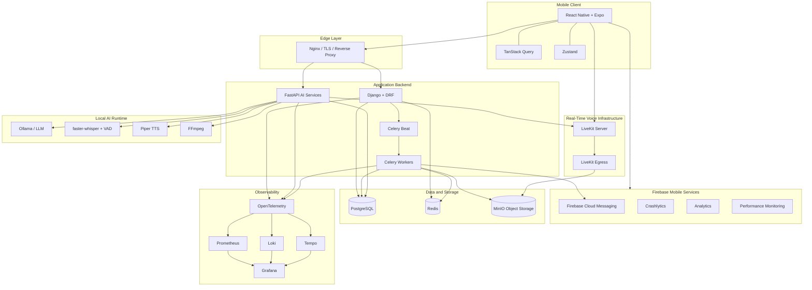

### Architecture principles

1.  Django owns business entities and lifecycle state.
2.  PostgreSQL is the source of truth for durable application data.
3.  Redis is a cache and task broker, not the system of record.
4.  AI processing is isolated behind service interfaces.
5.  LiveKit handles real-time audio transport.
6.  MinIO stores large media and document objects.
7.  Firebase provides mobile services only.
8.  Observability is built into every service.
9.  The mobile application is a client, not a trusted authority.
10. The design starts as a modular application with separately deployed
    AI/media workloads; it does not require a large microservice estate.

------------------------------------------------------------------------

## 6. System Components and Responsibilities

  -----------------------------------------------------------------------
  Component               Owns                    Does not own
  ----------------------- ----------------------- -----------------------
  React Native            UI, local navigation,   Business authorization
                          microphone interaction, or trusted scoring
                          user experience         

  Django                  Users, profiles,        Long-running real-time
                          interview lifecycle,    audio transport
                          reports, permissions    

  FastAPI                 AI orchestration and AI Primary user identity
                          service interfaces      or canonical interview
                                                  schedule

  PostgreSQL              Durable business state  Large recording
                                                  binaries

  Redis                   Cache, broker,          Durable interview
                          short-lived             records
                          coordination            

  Celery                  Background task         Authoritative business
                          execution               state

  LiveKit                 Real-time rooms and     Interview evaluation
                          audio transport         and user accounts

  Ollama                  Local LLM inference     User/account management

  faster-whisper          Speech recognition      Interview lifecycle

  Piper                   Speech synthesis        Conversation policy

  MinIO                   Object storage          Relational business
                                                  relationships

  Firebase                Push and mobile         Primary business
                          diagnostics/analytics   database or task queue

  Observability stack     Metrics, logs, traces,  Business data ownership
                          alerts                  
  -----------------------------------------------------------------------

------------------------------------------------------------------------

## 7. Voice Interview Lifecycle

### 7.1 Scheduling to completion

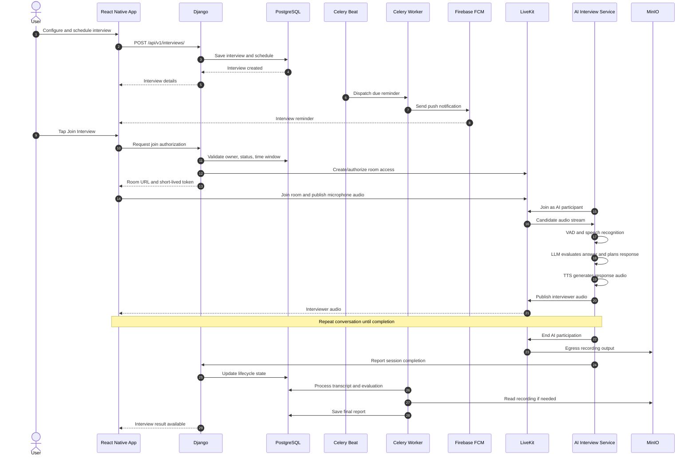

### 7.2 Audio conversation loop

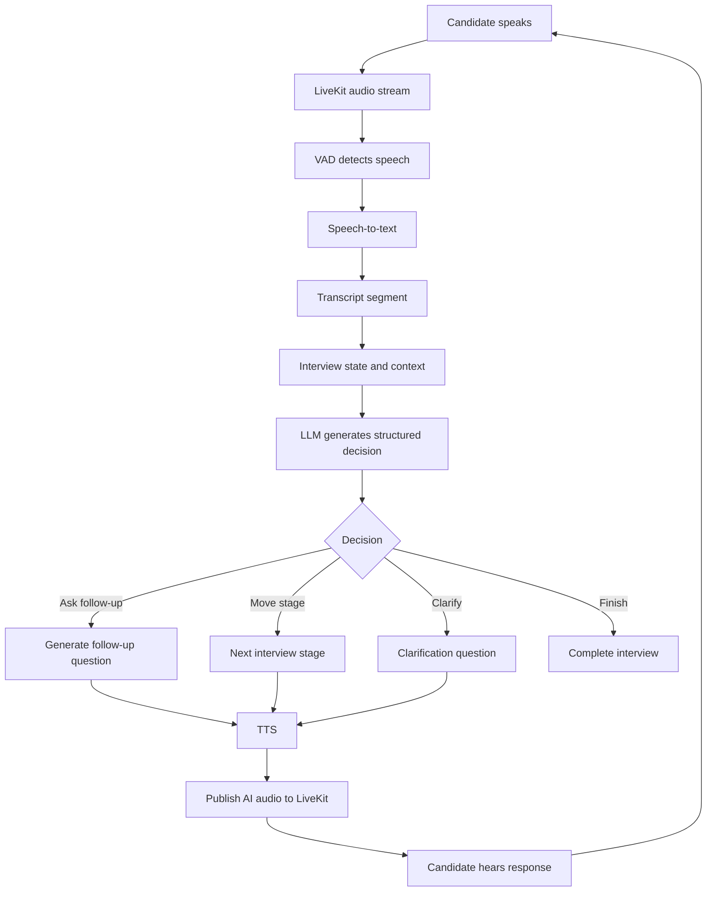

### 7.3 Latency considerations

The perceived response time is the sum of several stages:

-   Audio buffering and transport.
-   VAD segmentation.
-   Speech recognition.
-   LLM inference.
-   Speech synthesis.
-   Audio delivery.

Instrument each stage independently. The LLM is not automatically the
bottleneck; speech recognition, audio buffering, or TTS can also
dominate latency.

Use streaming or incremental processing where the chosen models and
pipeline support it. Do not sacrifice correctness or lose transcript
segments just to reduce latency.

------------------------------------------------------------------------

## 8. Interview State Machine

The application, not the LLM, controls the authoritative interview
lifecycle.

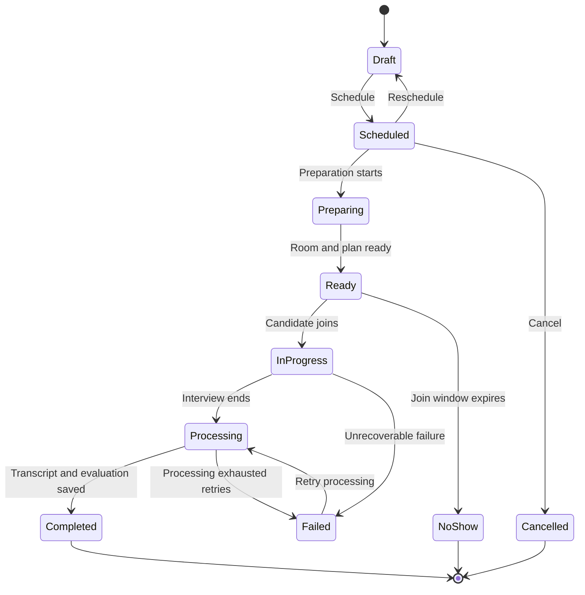

Suggested lifecycle statuses:

-   `DRAFT`
-   `SCHEDULED`
-   `PREPARING`
-   `READY`
-   `IN_PROGRESS`
-   `PROCESSING`
-   `COMPLETED`
-   `FAILED`
-   `CANCELLED`
-   `NO_SHOW`

The state machine must validate allowed transitions. Background jobs and
webhook handlers must be idempotent. A repeated event must not create
duplicate sessions, reports, notifications, or recordings.

------------------------------------------------------------------------

## 9. Resume Analysis Workflow

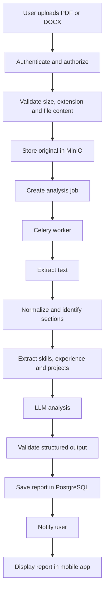

### Resume analysis categories

-   Contact and profile information completeness.
-   Summary quality.
-   Skills and evidence of skill usage.
-   Experience descriptions.
-   Projects and measurable outcomes.
-   Education and certifications.
-   Structure and readability.
-   Job-description relevance.
-   Missing or weakly evidenced requirements.
-   Actionable improvements.

### Resume processing safeguards

-   Allow only explicitly supported file types.
-   Enforce upload size limits.
-   Validate actual file content, not just filename extensions.
-   Treat extracted document content as untrusted data.
-   Do not execute embedded content, macros, or links.
-   Defend against prompt injection in resume text.
-   Keep analysis output schema-validated.
-   Restrict access to the owning user.
-   Define retention and deletion rules for originals and derived text.

------------------------------------------------------------------------

## 10. Push Notification Workflow

Firebase is used for push delivery. Django remains responsible for
deciding when and why a notification should be sent.

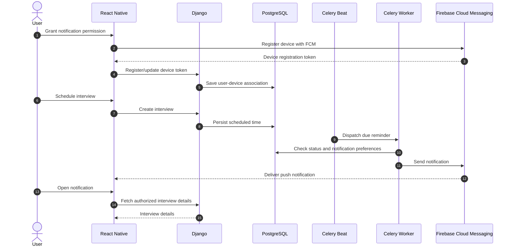

### Device model concept

A device registration should contain:

-   User relationship.
-   FCM token.
-   Platform (Android/iOS).
-   App version.
-   Device identifier where appropriate.
-   Active/inactive status.
-   Last registration/update time.
-   Token invalidation time.

A user can have multiple devices. Token refresh must update the existing
registration safely. Invalid or unregistered tokens must be deactivated
after provider responses indicate they are no longer valid.

### Notification security

-   Never expose Firebase Admin SDK credentials in the app.
-   The app submits its device token to the authenticated backend.
-   Do not trust a notification payload as authorization.
-   On notification tap, fetch the actual resource from Django.
-   Avoid including sensitive resume or interview content in push
    payloads.
-   Store delivery attempts and outcomes for troubleshooting.
-   Respect user notification preferences and time-zone settings.

------------------------------------------------------------------------

## 11. Database Architecture

PostgreSQL is the primary relational database. The following ER diagram
represents the main logical relationships. It is an initial domain
model; exact fields, cardinalities, constraints, and optional entities
will be refined during implementation.

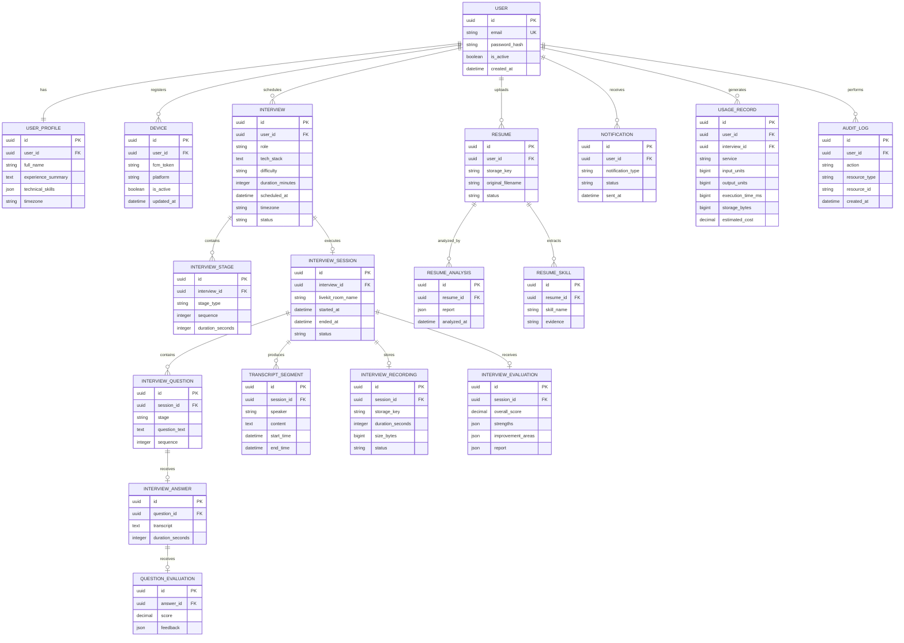

### Database design conventions

-   Use UUIDs for externally exposed entities.
-   Use timezone-aware timestamps and store a user's preferred time
    zone.
-   Add indexes for owner IDs, status, scheduled time, and frequently
    queried foreign keys.
-   Use relational columns for important business fields.
-   Use JSONB for flexible model output and evaluation details, with
    schema validation at application boundaries.
-   Keep recordings and uploaded files in object storage.
-   Store object keys and metadata in PostgreSQL.
-   Add uniqueness constraints and idempotency keys where duplicate
    operations are possible.
-   Use database transactions for state transitions that must be atomic.
-   Use migrations for all schema changes.

### Important data separation

  Data                                           Storage
  ---------------------------------------------- ------------
  User, interview, evaluation, device metadata   PostgreSQL
  Short-lived cache and task messages            Redis
  Original resume files                          MinIO
  Interview recordings                           MinIO
  Transcript text and timestamps                 PostgreSQL
  Logs                                           Loki
  Metrics                                        Prometheus
  Traces                                         Tempo

------------------------------------------------------------------------

## 12. Observability Architecture

Production readiness requires logs, metrics, traces, and actionable
alerts.

### Observability components

  Technology      Role
  --------------- ---------------------------------------------------
  OpenTelemetry   Instrumentation and telemetry conventions
  Prometheus      Scrape and store metrics
  Grafana         Dashboards and alert visualization
  Loki            Centralized log aggregation
  Tempo           Distributed trace storage and query
  Exporters       Expose host, database, Redis, and service metrics

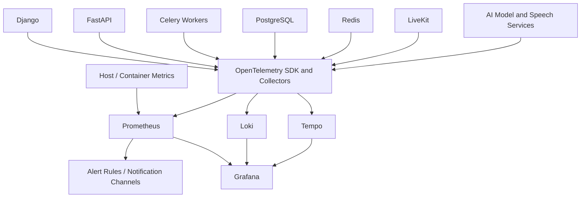

### 12.1 Logging

Use structured JSON logs.

Recommended common fields:

``` json
{
  "timestamp": "2026-01-01T12:00:00Z",
  "level": "INFO",
  "service": "interview-api",
  "environment": "production",
  "message": "Interview session created",
  "request_id": "request-uuid",
  "trace_id": "trace-id",
  "user_id": "internal-user-id",
  "interview_id": "interview-uuid",
  "session_id": "session-uuid"
}
```

The values above are illustrative.

Log:

-   Request start/end and duration.
-   HTTP method, route template, status code.
-   Background task start/end, retries, and failures.
-   Interview lifecycle transitions.
-   AI inference duration and model identifier.
-   Speech recognition and synthesis duration.
-   Recording and upload outcomes.
-   Database errors and slow-query diagnostics.
-   External/internal service communication failures.

Never log passwords, access tokens, private keys, raw audio, or
unnecessary personal data. Avoid using user IDs, interview IDs, or other
high-cardinality identifiers as Prometheus metric labels; keep those
identifiers in logs and traces.

### 12.2 Metrics

  ---------------------------------------------------------------------
  Component                          Example metrics
  ---------------------------------- ----------------------------------
  Django                             Request rate, error rate,
                                     P50/P95/P99 latency

  FastAPI                            Request latency, active sessions,
                                     exceptions

  PostgreSQL                         Active connections, locks, slow
                                     queries, cache hit ratio

  Redis                              Memory, connections, command
                                     latency, evictions

  Celery                             Queue depth, task runtime,
                                     retries, failures

  Ollama                             Inference duration, model
                                     availability, resource use

  STT                                Audio processing duration,
                                     processing backlog

  TTS                                Synthesis duration and failures

  LiveKit                            Active rooms, participants, packet
                                     loss, reconnects

  MinIO                              Storage size, object operations,
                                     failed uploads

  Host                               CPU, RAM, disk, network, container
                                     restarts
  ---------------------------------------------------------------------

### 12.3 Distributed tracing

Example trace for a slow AI response:

``` text
Interview turn
  |
  |-- Receive audio
  |-- VAD segmentation
  |-- Speech-to-text
  |-- Context retrieval
  |-- LLM inference
  |-- Response validation
  |-- Text-to-speech
  |-- Publish audio
  |
  Total turn latency
```

Propagate trace context across HTTP requests, task messages, and service
calls where supported. Use trace IDs to correlate logs and traces.

### 12.4 Initial alert examples

These are starting thresholds to be tuned after load testing.

  Condition                                              Initial severity
  ------------------------------------------------------ ------------------
  API error rate above 5%                                Critical
  API P95 latency above 2 seconds for sustained period   Warning
  Voice turn latency above target                        Warning
  CPU above 90% for 5 minutes                            Warning
  Memory above 85%                                       Warning
  Disk above 85%                                         Warning
  PostgreSQL connections near configured limit           Critical
  Celery queue backlog above threshold                   Warning
  Recording upload failures                              Critical
  AI service unavailable                                 Critical

Alerts should include a useful service name, environment, runbook link,
and relevant dashboard. Avoid alerting on a single transient sample.

------------------------------------------------------------------------

## 13. Usage and Cost Monitoring

The application should measure usage even when local inference has no
per-token API charge.

### 13.1 Usage dimensions

-   LLM input/output tokens where the runtime exposes them.
-   Speech-to-text audio seconds.
-   Text-to-speech characters or generated audio duration.
-   Model inference duration.
-   CPU time and peak memory where measurable.
-   Interview duration.
-   Recording size.
-   Resume file size and analysis duration.
-   Storage growth.
-   Network traffic where measurable.

### 13.2 Usage record concept

An initial usage record may contain:

``` python
class UsageRecord:
    user_id
    interview_id
    service
    operation
    input_units
    output_units
    execution_time_ms
    cpu_time_ms
    memory_peak_mb
    storage_bytes
    estimated_cost
    created_at
```

This is a domain sketch, not final Django model code.

### 13.3 Cost calculation

For a self-hosted service, monetary API expenditure may be zero, but
infrastructure is not free.

An estimated compute allocation can be calculated as:

``` text
Estimated compute cost =
    CPU resource allocation
  + RAM resource allocation
  + GPU resource allocation (if applicable)
  + electricity / hosting allocation
```

Storage allocation can be calculated using:

``` text
Estimated storage cost =
    stored GB × configured cost per GB-month
```

Use configurable rates and clearly label estimates. Do not present
resource estimates as actual cloud bills.

### 13.4 Cost and usage dashboards

-   Total interviews and resume analyses.
-   Average resource consumption per interview.
-   LLM inference time and tokens.
-   STT and TTS processing time.
-   Recording storage by day/month.
-   Storage retention and deletion.
-   Resource consumption by service.
-   Estimated cost per interview.
-   Estimated cost per active user.
-   Queue backlog and processing capacity.

Apply per-user quotas and abuse controls so one user cannot exhaust
shared compute resources.

------------------------------------------------------------------------

## 14. Security, Privacy, and Reliability

### 14.0 Authentication architecture and implementation choices

Keep identity integrations behind a dedicated authentication boundary.
Application services should consume a normalized local `User`,
authentication result, and authorization context; they should not
depend directly on Google, Apple, Okta, Microsoft Entra ID, Auth0, or
another provider's SDK types.

Recommended implementation direction:

-   **Core identity:** Django custom user model and Django authentication.
-   **JWT/session lifecycle:** Django REST Framework SimpleJWT, with
    refresh rotation and the token blacklist app enabled for revocation.
    Keep session/device records in InterviewAI's database so users can
    inspect and revoke sessions.
-   **Identity integration candidate:** evaluate `django-allauth`
    (including its headless/API capabilities) as the first choice for
    local accounts, social providers, MFA, OIDC, SAML, and mobile/API
    flows. Its current feature set documents TOTP, recovery codes,
    WebAuthn/passkeys, social providers, OIDC, SAML, and headless
    support for native clients. Verify exact version compatibility,
    callback/deep-link behavior, API contract, and operational needs
    before locking dependencies.
-   **Social login and account linking:** use allauth social-account
    providers for Google and Apple first. Use authorization-code flows
    and PKCE for public/mobile clients where supported. Do not enable
    automatic email-based account linking globally.
-   **MFA and recovery:** use allauth MFA for TOTP, recovery codes, and
    (when enabled) WebAuthn/passkeys if the selected release meets the
    requirements. Otherwise add a focused adapter/library behind the
    internal `MFAProvider` interface.
-   **Enterprise OIDC and SAML 2.0:** prefer allauth's maintained
    protocol integrations if they satisfy organization-level SSO
    requirements. If not, use a dedicated maintained OIDC or SAML
    service-provider library behind the same normalized
    `EnterpriseSSOProvider` boundary. OIDC and SAML have different
    protocol mechanics; do not pretend one adapter is interchangeable
    with the other.
-   **JWT contract:** decide whether to retain SimpleJWT or adopt the
    allauth headless token strategy only after a proof-of-concept. There
    must be one authoritative token/session lifecycle, not two competing
    systems. Preserve the public API token contract behind our own
    authentication service where feasible.
-   **Policy:** create an internal authentication policy service that
    decides whether a user/org requires MFA, which methods are allowed,
    whether SSO is mandatory, and whether local password login is
    permitted. Keep these decisions out of views and provider callbacks.

The identity flow is:

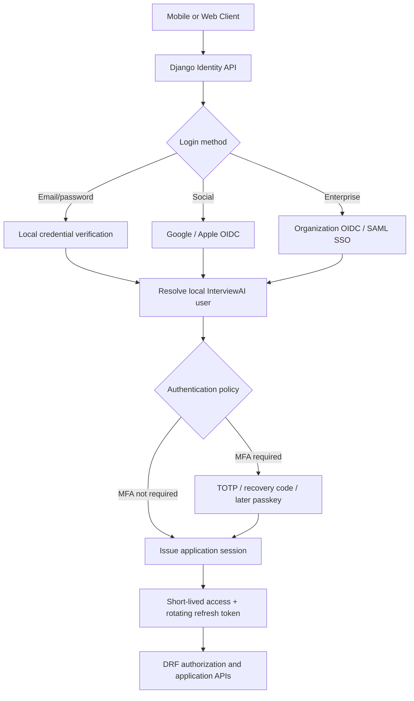

Security and portability requirements:

-   Keep provider identifiers, issuer URLs, client IDs, secrets,
    certificates, and redirect URIs in protected environment/secret
    configuration, never source code.
-   Store external subject identifiers (`issuer` + `subject`) as the
    stable identity key. Email is an attribute, not a globally unique
    federation key.
-   Validate OAuth/OIDC `state`, `nonce`, PKCE verifier, issuer,
    audience, signature, and exact redirect URI. Validate SAML issuer,
    audience, destination, recipient, timestamps, signature, and
    replay protection.
-   Use an explicit account-linking flow initiated by an authenticated
    user. Require recent re-authentication and verified provider
    identity; protect against account takeover and unintended merging.
-   Encrypt sensitive provider configuration and MFA secrets at rest.
    Hash recovery codes; show them only once. Never log passwords,
    access/refresh tokens, TOTP secrets, recovery codes, authorization
    codes, or SAML assertions.
-   Audit login success/failure, MFA enrollment/removal, recovery,
    account linking, SSO policy changes, session revocation, and
    suspicious authentication activity. Keep audit records append-only
    where practical.
-   Apply rate limits, progressive delays/lockouts, and abuse detection
    to password, OTP, recovery, reset, and callback flows.
-   Use a consistent local account and authorization model even if the
    user signs in through multiple providers. Social/SSO provider claims
    must not directly set InterviewAI admin or privileged roles.
-   For enterprise SSO, map organization membership and approved
    identity claims to local roles through explicit, reviewed rules.
    Plan SCIM user/group provisioning as a later extension, not a
    prerequisite for first SSO login.

Provider portability has limits: changing from Google to Apple or from
one OIDC/SAML identity provider to another is usually configuration
plus provider registration and verification. Switching protocol
families (OIDC to SAML), adding a new factor, or changing authentication
libraries requires an adapter/configuration change and security
regression tests. Do not promise environment-only switching for every
identity integration.

### 14.1 Authentication, MFA, SSO, and authorization

-   Django owns the local user identity, account status, roles,
    permissions, and application authorization.
-   Use Django's password hashers and password validation; never store
    plaintext passwords or authentication secrets.
-   Verify email addresses and provide a secure password-reset flow.
-   Use short-lived access tokens, refresh-token rotation, token
    revocation/blacklisting, and server-side session/device records.
-   Require re-authentication for sensitive actions such as changing
    password, email, MFA methods, or linked identity providers.
-   Offer TOTP MFA with single-use recovery codes; make MFA enrollment,
    challenge, disablement, and recovery auditable.
-   Add WebAuthn/passkeys after the initial TOTP flow is stable.
-   Support Google and Apple social login with OAuth 2.0/OIDC-based
    authorization-code flows and PKCE where appropriate for mobile.
-   Support enterprise OIDC and SAML 2.0 SSO as organization-scoped
    integrations. Validate issuer, audience, signature, state, nonce,
    redirect URI, and SAML assertions; rotate and protect signing keys.
-   Require verified external email claims before using them in account
    linking. Do not auto-link accounts solely by matching email.
-   Define organization policies for SSO enforcement, MFA requirement,
    allowed domains/providers, and just-in-time provisioning. SCIM
    provisioning can be added as a later enterprise capability.
-   Enforce ownership checks on every user-specific resource.
-   Do not trust user IDs or role claims supplied by the mobile client.
-   Use short-lived LiveKit room tokens and keep service credentials on
    the server.
-   Rate-limit login, registration, MFA verification, password reset,
    social callbacks, SSO callbacks, uploads, scheduling, and AI
    operations. Add brute-force protection and suspicious-login audit
    events without logging secrets or OTP values.
-   Provide account recovery that does not allow MFA to be bypassed by
    an insecure email-only shortcut.

### 14.2 Recording and resume privacy

-   Disclose recording before the interview.
-   Obtain explicit consent.
-   Store private objects with access control.
-   Use short-lived signed URLs or authenticated media delivery.
-   Define configurable retention periods.
-   Support user-requested deletion.
-   Delete derived artifacts where required by the retention policy.
-   Avoid exposing private file keys or public bucket listings.

### 14.3 Upload security

-   Enforce maximum file size.
-   Validate MIME type and file signature.
-   Use generated object names rather than trusting filenames.
-   Treat document text as untrusted input.
-   Protect against malicious or malformed documents.
-   Consider malware scanning before public launch.
-   Restrict file access to the owner and authorized services.

### 14.4 Reliability

-   Idempotent scheduled jobs.
-   Retry with exponential backoff and jitter.
-   Bounded retries and dead-letter handling.
-   Database transactions for lifecycle transitions.
-   Graceful shutdown of workers.
-   Health, readiness, and liveness checks.
-   Reconnection handling for interrupted voice sessions.
-   Separate recording completion from evaluation completion.
-   Database backup and restore drills.
-   Object-storage backup strategy.
-   Explicit failure states and user-facing recovery messages.

### 14.5 AI output safeguards

-   Validate structured model output.
-   Constrain interview stages and question limits.
-   Do not let the LLM change authoritative session state directly.
-   Treat resume and transcript content as untrusted data.
-   Protect prompts and tools from document-based prompt injection.
-   Explain scoring criteria and limitations.
-   Avoid sensitive or discriminatory inferences.
-   Keep human-readable evidence for generated feedback.

------------------------------------------------------------------------

## 15. Repository Structure

The initial repository is a monorepo with independently organized
backend, AI, mobile, and infrastructure code.

``` text
interview-ai/
│
├── backend/
│   ├── config/
│   │   ├── settings/
│   │   │   ├── base.py
│   │   │   ├── development.py
│   │   │   └── production.py
│   │   ├── urls.py
│   │   ├── asgi.py
│   │   └── celery.py
│   │
│   ├── apps/
│   │   ├── accounts/
│   │   ├── profiles/
│   │   ├── interviews/
│   │   ├── interview_sessions/
│   │   ├── questions/
│   │   ├── evaluations/
│   │   ├── recordings/
│   │   ├── resumes/
│   │   ├── notifications/
│   │   ├── devices/
│   │   ├── analytics/
│   │   ├── usage/
│   │   ├── audit/
│   │   └── common/
│   │
│   ├── tests/
│   ├── requirements/
│   └── manage.py
│
├── ai_services/
│   ├── interview_engine/
│   │   ├── agents/
│   │   ├── state_machine/
│   │   ├── prompts/
│   │   ├── evaluators/
│   │   └── orchestrator/
│   ├── speech_to_text/
│   ├── text_to_speech/
│   ├── audio_processing/
│   ├── resume_analyzer/
│   ├── common/
│   └── main.py
│
├── mobile/
│   ├── app/
│   │   ├── (auth)/
│   │   ├── (tabs)/
│   │   ├── interviews/
│   │   ├── resume/
│   │   ├── recordings/
│   │   └── _layout.tsx
│   ├── src/
│   │   ├── components/
│   │   ├── features/
│   │   ├── hooks/
│   │   ├── services/
│   │   │   ├── api/
│   │   │   ├── firebase/
│   │   │   ├── livekit/
│   │   │   └── notifications/
│   │   ├── stores/
│   │   ├── types/
│   │   └── utils/
│   ├── assets/
│   ├── app.json
│   └── package.json
│
├── infrastructure/
│   ├── docker/
│   ├── nginx/
│   ├── livekit/
│   ├── prometheus/
│   ├── grafana/
│   ├── loki/
│   ├── tempo/
│   ├── alerts/
│   └── scripts/
│
├── docs/
│   ├── architecture/
│   ├── api/
│   ├── database/
│   ├── deployment/
│   └── runbooks/
│
├── scripts/
├── docker-compose.yml
├── .env.example
├── .gitignore
└── README.md
```

The directory structure is a target structure. We should create folders
as their implementation phase begins rather than generating empty
modules prematurely.

------------------------------------------------------------------------

## 16. API Design

All application APIs are versioned under `/api/v1/`.

### Authentication and identity

The following is the target API contract; endpoints will be introduced
in stages. OAuth/OIDC and SAML protocol callbacks may use dedicated
provider callback routes rather than the JSON API pattern.

  Method   Endpoint                                      Purpose
  -------- --------------------------------------------- --------------------------------------
  POST     `/api/v1/auth/register/`                      Register with email/password
  POST     `/api/v1/auth/login/`                         Begin password login / receive MFA challenge
  POST     `/api/v1/auth/token/`                         Obtain JWT after required factors pass
  POST     `/api/v1/auth/refresh/`                       Rotate/refresh token pair
  POST     `/api/v1/auth/logout/`                        Revoke current refresh session
  POST     `/api/v1/auth/logout-all/`                    Revoke all user sessions
  GET      `/api/v1/auth/me/`                            Current user and authentication state
  POST     `/api/v1/auth/email/verify/`                  Verify email address
  POST     `/api/v1/auth/password/forgot/`               Start password reset
  POST     `/api/v1/auth/password/reset/`                Complete password reset
  GET      `/api/v1/auth/mfa/`                           MFA enrollment/status
  POST     `/api/v1/auth/mfa/totp/enroll/`               Start TOTP enrollment
  POST     `/api/v1/auth/mfa/totp/confirm/`              Confirm TOTP and enable MFA
  POST     `/api/v1/auth/mfa/challenge/`                 Verify second factor during login
  POST     `/api/v1/auth/mfa/recovery-codes/regenerate/` Regenerate recovery codes
  DELETE   `/api/v1/auth/mfa/totp/`                      Disable TOTP after re-authentication
  GET      `/api/v1/auth/sessions/`                      List active sessions/devices
  DELETE   `/api/v1/auth/sessions/{id}/`                 Revoke a session/device
  GET      `/api/v1/auth/identities/`                    List linked social identities
  POST     `/api/v1/auth/identities/{provider}/link/`    Begin explicit account linking
  DELETE   `/api/v1/auth/identities/{provider}/`         Unlink identity after safety checks

Social login providers (Google/Apple initially) and enterprise SSO
(OIDC/SAML 2.0) will have provider-specific authorization/callback
routes managed by the identity integration layer. Organization
administration endpoints for SSO and MFA policies will be added with
the organization/enterprise feature set. Do not treat this target
endpoint list as implemented in the Phase 1 starter scaffold.

### Profile

  Method   Endpoint                    Purpose
  -------- --------------------------- ----------------
  GET      `/api/v1/profile/`          Get profile
  PATCH    `/api/v1/profile/`          Update profile
  PUT      `/api/v1/profile/skills/`   Update skills

### Interviews

  Method   Endpoint                                Purpose
  -------- --------------------------------------- -------------------------
  GET      `/api/v1/interviews/`                   List interviews
  POST     `/api/v1/interviews/`                   Create interview
  GET      `/api/v1/interviews/{id}/`              Interview details
  PATCH    `/api/v1/interviews/{id}/`              Update permitted fields
  POST     `/api/v1/interviews/{id}/schedule/`     Schedule
  POST     `/api/v1/interviews/{id}/reschedule/`   Reschedule
  POST     `/api/v1/interviews/{id}/cancel/`       Cancel

### Interview sessions

  -----------------------------------------------------------------------------
  Method              Endpoint                              Purpose
  ------------------- ------------------------------------- -------------------
  POST                `/api/v1/sessions/{id}/join/`         Authorize joining
                                                            and issue
                                                            short-lived room
                                                            token

  POST                `/api/v1/sessions/{id}/end/`          Request controlled
                                                            session end

  GET                 `/api/v1/sessions/{id}/`              Session status

  GET                 `/api/v1/sessions/{id}/result/`       Evaluation report

  GET                 `/api/v1/sessions/{id}/transcript/`   Transcript

  GET                 `/api/v1/sessions/{id}/recording/`    Authorized playback
                                                            URL or media
                                                            response
  -----------------------------------------------------------------------------

LiveKit audio does not travel through normal REST endpoints. It uses the
real-time media connection.

### Resume analyzer

  Method   Endpoint                           Purpose
  -------- ---------------------------------- -----------------
  POST     `/api/v1/resumes/upload/`          Upload resume
  GET      `/api/v1/resumes/`                 List resumes
  GET      `/api/v1/resumes/{id}/`            Resume details
  POST     `/api/v1/resumes/{id}/analyze/`    Start analysis
  GET      `/api/v1/resumes/{id}/analysis/`   Retrieve report

### Devices and notifications

  Method   Endpoint                              Purpose
  -------- ------------------------------------- ---------------------------
  POST     `/api/v1/devices/register/`           Register/update FCM token
  DELETE   `/api/v1/devices/{id}/`               Deactivate device
  GET      `/api/v1/notifications/`              List notifications
  PATCH    `/api/v1/notifications/{id}/read/`    Mark notification read
  GET      `/api/v1/notification-preferences/`   Read preferences
  PATCH    `/api/v1/notification-preferences/`   Update preferences

### Analytics and usage

  Method   Endpoint                          Purpose
  -------- --------------------------------- ----------------------------
  GET      `/api/v1/analytics/dashboard/`    User performance dashboard
  GET      `/api/v1/analytics/interviews/`   Interview trends
  GET      `/api/v1/usage/summary/`          User usage summary

Administrative operational metrics should be protected separately and
generally served through the observability stack rather than exposing
Prometheus directly to mobile clients.

------------------------------------------------------------------------

## 17. Deployment Architecture

### 17.1 Initial local deployment

Use Docker Compose to run the backend dependencies locally.

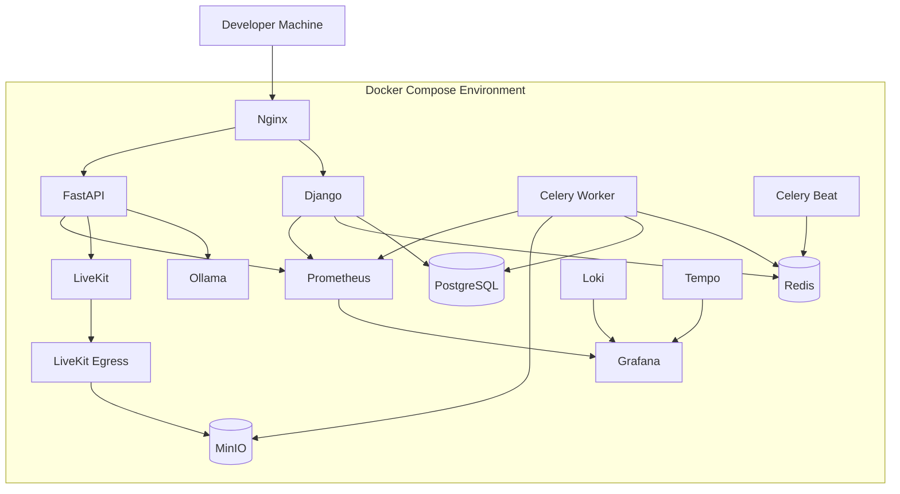

Some services, particularly local model inference, LiveKit Egress, and
observability, can consume substantial resources. The development
Compose profile should allow optional services to be started
independently.

### 17.2 Production deployment roles

These are logical workload roles. They do not require a separate
physical server for every row.

  Workload           Responsibilities
  ------------------ ---------------------------------------
  Edge/application   Nginx, Django, FastAPI
  Database           PostgreSQL and backup process
  Worker             Celery workers and scheduled tasks
  AI compute         Ollama, STT, TTS
  Real-time media    LiveKit and Egress
  Storage            MinIO and backup/replication strategy
  Observability      Prometheus, Grafana, Loki, Tempo

Start with a small deployment and separate the AI/media workloads when
resource measurements justify it.

### 17.3 Deployment safeguards

-   HTTPS everywhere.
-   Production-only secrets and environment variables.
-   No development debug mode.
-   Restricted database and Redis network exposure.
-   Private object-storage buckets.
-   Firewall and network segmentation.
-   Database backup and restore tests.
-   Monitoring retention limits.
-   Container health checks.
-   CI/CD quality gates.
-   Rolling or controlled deployments.
-   Migration safety and rollback planning.

------------------------------------------------------------------------

## 18. Development Roadmap

The implementation starts with the backend. The mobile application comes
after the backend APIs and AI workflows are stable.

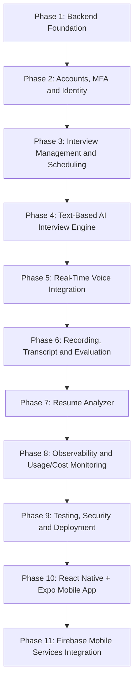

### Phase 1 --- Backend foundation

-   Create repository and Python environment.
-   Create Django project and settings separation.
-   Configure PostgreSQL.
-   Configure Redis.
-   Add Docker Compose.
-   Create custom user model before initial migrations.
-   Add DRF and JWT authentication foundation.
-   Enable token rotation/revocation support and create the initial
    session/device and audit-event design (full flows follow in Phase 2).
-   Keep authentication provider integrations behind a dedicated
    identity boundary; do not couple application code to social/SSO SDKs.
-   Configure environment variables and secrets.
-   Add health/readiness endpoints.
-   Add formatting, linting, and test setup.
-   Add structured logging conventions.

**Deliverable:** A runnable, tested backend foundation.

### Phase 2 --- Accounts, MFA, and identity

Implement authentication in controlled increments, with security tests
for every flow.

1. **Core account security**
   - Registration, email verification, login, logout, password reset.
   - JWT refresh rotation, revocation/blacklisting, and session/device
     management.
   - Login throttling, brute-force controls, audit events, and secure
     account recovery.
2. **MFA / 2FA**
   - TOTP authenticator enrollment and challenge.
   - Single-use recovery codes, regeneration, and secure storage.
   - Re-authentication before adding/removing factors or changing
     sensitive account settings.
   - Configurable per-user and later per-organization MFA requirement.
   - WebAuthn/passkeys as a subsequent enhancement.
3. **Social login**
   - Google and Apple first.
   - Explicit account linking/unlinking, verified email handling, and
     protection against accidental account merges.
4. **Enterprise SSO**
   - OIDC SSO first, with organization-scoped issuer/client settings.
   - SAML 2.0 support through a separate protocol adapter.
   - SSO enforcement and local-login policy per organization.
   - SCIM provisioning can follow after SSO is stable.
5. **Profile and authorization**
   - User profile, skills, experience, target roles.
   - Local roles/permissions remain authoritative.
   - Authorization and identity-flow integration tests.

**Deliverable:** Secure identity foundation supporting local login,
MFA/2FA, Google/Apple social login, and an extensible enterprise SSO
boundary. WebAuthn and SCIM are planned follow-on capabilities.

### Phase 3 --- Interview management and scheduling

-   Interview models and migrations.
-   Interview configuration APIs.
-   Scheduling and time-zone handling.
-   Celery and Celery Beat.
-   Idempotent reminder dispatch.
-   Interview lifecycle and cancellation.
-   Notification records.

**Deliverable:** Users can schedule and manage mock interviews.

### Phase 4 --- Text-based AI interview engine

-   Install and evaluate Ollama.
-   Select an appropriately licensed model.
-   Create an LLM service abstraction.
-   Design interview prompts and structured output.
-   Implement interview state machine.
-   Generate questions and follow-ups.
-   Evaluate answers.
-   Test model latency and memory requirements.

**Deliverable:** A working text-based AI interviewer.

### Phase 5 --- Real-time voice integration

-   Deploy LiveKit locally.
-   Integrate room-token authorization.
-   Build AI participant/agent.
-   Integrate VAD, STT, LLM, and TTS.
-   Handle interruptions and reconnections.
-   Measure end-to-end voice latency.

**Deliverable:** A working in-app AI voice interview.

### Phase 6 --- Recording and evaluation

-   Deploy Egress.
-   Configure MinIO.
-   Record interview sessions.
-   Process transcript segments.
-   Generate final evaluations.
-   Add playback authorization.
-   Add retention and deletion handling.

**Deliverable:** Complete interview history with recording and feedback.

### Phase 7 --- Resume analyzer

-   PDF/DOCX upload.
-   Validation and storage.
-   Parsing and section extraction.
-   Structured LLM analysis.
-   Job-description matching.
-   Report storage and retrieval.
-   Security and file-processing tests.

**Deliverable:** Working resume analyzer.

### Phase 8 --- Observability and usage

-   OpenTelemetry instrumentation.
-   Prometheus metrics.
-   Grafana dashboards.
-   Loki logs.
-   Tempo traces.
-   Celery monitoring.
-   Database and Redis metrics.
-   AI resource measurements.
-   Storage accounting.
-   Alert rules and runbooks.

**Deliverable:** Operational monitoring and resource/cost visibility.

### Phase 9 --- Testing, security, and deployment

-   Unit tests.
-   Integration tests.
-   API contract tests.
-   Load tests.
-   Voice interruption/reconnection tests.
-   Failure recovery tests.
-   Security review.
-   Backup and restore drills.
-   CI/CD.
-   Production deployment.

**Deliverable:** A tested and deployable backend.

### Phase 10 --- React Native application

-   Expo project with TypeScript.
-   Authentication screens.
-   Dashboard and profile.
-   Interview scheduling.
-   LiveKit interview room.
-   Results and recording playback.
-   Resume upload and report.
-   Interview history and analytics.
-   Mobile error and loading states.

**Deliverable:** Complete Android/iOS client.

### Phase 11 --- Firebase integration

-   Configure Firebase project.
-   Integrate FCM.
-   Register and refresh device tokens.
-   Send push notifications from backend.
-   Configure Crashlytics.
-   Configure Analytics.
-   Configure Performance Monitoring.
-   Test Android and iOS notification behavior.

**Deliverable:** Integrated mobile notification and diagnostics layer.

------------------------------------------------------------------------

## 19. Local Development Strategy

The project should be developed locally before public deployment.

### Initial prerequisites

-   Python 3.12 or a compatible supported version.
-   Docker and Docker Compose.
-   Git.
-   Node.js LTS.
-   PostgreSQL and Redis through Docker.
-   Android Studio or an appropriate Android device/emulator for mobile
    work.
-   Sufficient RAM and disk for selected AI models.

### Hardware planning

Local AI inference is hardware-dependent. A small CPU-only machine can
be used to develop APIs and test workflows, but may not deliver
low-latency voice conversations.

The following must be benchmarked on the actual machine:

-   Model loading time.
-   Peak RAM and GPU memory.
-   Tokens per second.
-   STT real-time factor.
-   TTS generation time.
-   Concurrent interview capacity.
-   Recording throughput.
-   Container resource overhead.

Begin with small models and short audio segments. Do not promise
production concurrency until measured.

### Development environment principles

-   Use `.env` files locally and never commit secrets.
-   Keep `.env.example` with documented variable names and safe
    placeholders.
-   Separate development and production settings.
-   Pin and audit dependencies.
-   Run migrations through the deployment workflow.
-   Provide health checks for all services.
-   Make optional heavy services configurable in Compose.
-   Keep sample data and test fixtures separate from real user data.

------------------------------------------------------------------------

## 20. Important Architecture Decisions

  -----------------------------------------------------------------------
  Decision                Choice                  Reason
  ----------------------- ----------------------- -----------------------
  Mobile instead of       React Native + Expo     Android/iOS from a
  web-first                                       shared TypeScript
                                                  codebase

  Main backend            Django + DRF            Mature application
                                                  framework, ORM,
                                                  authentication, admin

  AI backend              FastAPI                 Isolated AI interfaces
                                                  and async-friendly
                                                  service layer

  Primary data store      PostgreSQL              Relational integrity
                                                  and JSONB support

  Cache and queue broker  Redis                   Fast ephemeral data and
                                                  Celery transport

  Background jobs         Celery                  Durable
                                                  application-level task
                                                  execution and retries

  Real-time audio         LiveKit                 Purpose-built real-time
                                                  communication

  Local AI                Ollama and local speech Avoid mandatory paid
                          models                  inference APIs

  File storage            MinIO                   S3-compatible object
                                                  storage

  Firebase scope          FCM and mobile          Mobile support without
                          diagnostics/analytics   replacing backend data
                                                  systems

  Observability           Prometheus, Grafana,    Metrics, logs, traces,
                          Loki, Tempo,            and dashboards
                          OpenTelemetry           

  Deployment              Docker Compose first    Simpler development and
                                                  initial deployment
  -----------------------------------------------------------------------

### 20.1 Firebase is not the primary backend

Firebase is used only for mobile services:

-   FCM for push notifications.
-   Crashlytics for mobile crash reports.
-   Analytics for mobile product events.
-   Performance Monitoring for mobile performance.
-   App Check for supported Firebase resources.

The following remain unchanged:

-   PostgreSQL is the primary database.
-   Redis is the cache and Celery broker.
-   Django owns authentication and business logic.
-   Celery executes background jobs.
-   MinIO stores files.
-   FastAPI hosts AI service interfaces.

### 20.2 Modular monolith before microservices

Django should start as a modular monolith organized by domain. AI
inference and real-time media are separate processes because they have
different resource and scaling characteristics.

Do not split every Django app into its own network service without a
measurable reason.

### 20.3 No paid AI APIs by default

The initial design uses local/self-hosted models. This avoids mandatory
per-call provider fees but does not make hosting, hardware, electricity,
bandwidth, domain registration, or app-store publishing free.

### 20.4 Measure before scaling

Use load tests and production telemetry to decide when to:

-   Separate AI workers.
-   Add GPU inference.
-   Increase database resources.
-   Separate media infrastructure.
-   Add more Celery workers.
-   Introduce a dedicated object-storage deployment.
-   Adopt orchestration beyond Docker Compose.

------------------------------------------------------------------------

## 21. License and Model Considerations

The platform is intended to be usable without mandatory paid AI APIs.
Before selecting production model assets, verify:

-   The model's weight license.
-   Commercial-use permission.
-   Redistribution restrictions.
-   Voice model licensing.
-   Runtime software license.
-   Dependency licenses.
-   Any attribution requirements.

Do not assume that an open-source runtime means every model distributed
through it is commercially unrestricted.

Also review the current pricing and quotas of Firebase services before
launch. Free availability can differ by product, region, platform, and
usage level.

------------------------------------------------------------------------

## Project Development Principle

**Build each capability end-to-end, test it, instrument it, and document
it before moving to the next phase.**

The first implementation milestone is Phase 1: backend foundation with
Django, PostgreSQL, Redis, Docker Compose, a custom user model, a secure
JWT/session foundation, health checks, structured logging, and automated
tests. Phase 2 expands this foundation to email verification, password
recovery, MFA/2FA, Google/Apple social login, and enterprise OIDC/SAML SSO.

The mobile application will be implemented after the backend contracts
and core workflows are established.

------------------------------------------------------------------------

## Architecture References

The following official documentation informed the provider-portability
design. Re-check versions and provider capabilities when implementation
begins.

-   [LiteLLM documentation](https://docs.litellm.ai/docs/) --- unified
    LLM interface, supported providers, retries, routing, and optional
    proxy gateway.
-   [LiteLLM supported
    providers](https://docs.litellm.ai/docs/providers) --- hosted and
    self-hosted provider integrations, including Ollama.
-   [LiveKit Agents models
    overview](https://docs.livekit.io/agents/models/) --- model
    interfaces and provider plugins for LLM, STT, and TTS.
-   [LiveKit Agents LLM
    overview](https://docs.livekit.io/agents/models/llm/) --- LLM
    plugins and OpenAI-compatible endpoint configuration.
-   [LiveKit Agents STT
    overview](https://docs.livekit.io/agents/models/stt/) ---
    speech-to-text provider integrations and capabilities.
-   [LiveKit Agents TTS
    overview](https://docs.livekit.io/agents/models/tts/) ---
    text-to-speech provider integrations and capabilities.
-   [Django file storage
    API](https://docs.djangoproject.com/en/5.2/ref/files/storage/) ---
    storage backend abstraction.
-   [Celery
    configuration](https://docs.celeryq.dev/en/stable/userguide/configuration.html)
    --- configurable broker transports.

-   [django-allauth MFA](https://docs.allauth.org/en/latest/mfa/introduction.html)
-   [django-allauth social providers](https://docs.allauth.org/en/latest/socialaccount/providers/index.html)
-   [django-allauth feature overview](https://allauth.org/features/)